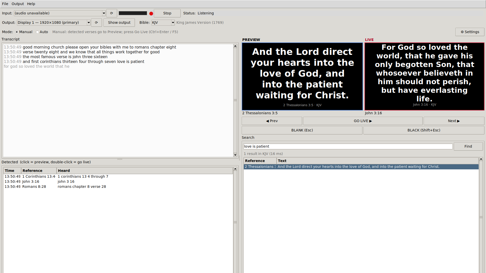
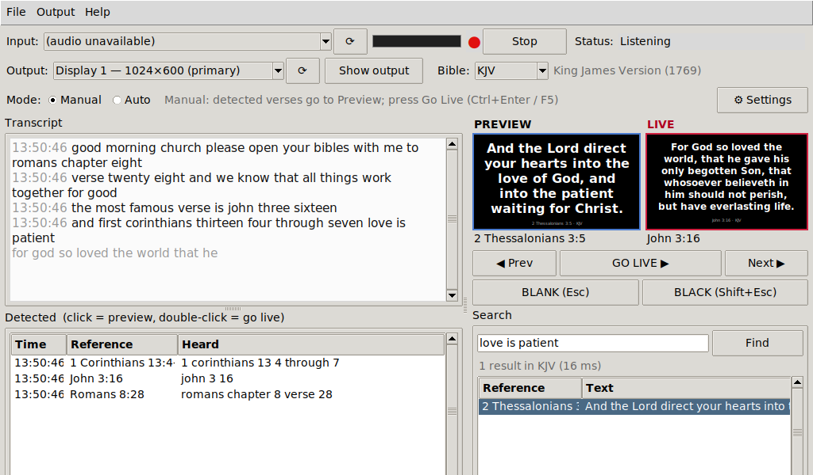

# BiVerse

**Free, offline Bible-verse projection driven by live speech.** BiVerse listens to the
preacher, recognises spoken Bible references ("John chapter three verse sixteen") and shows
the verse full-screen on the projector or TV you choose. Everything runs on the church
computer. There is no internet connection, account, cloud service or telemetry.



| Operator window on a 1024×600 netbook | What the congregation sees |
|---|---|
|  |  |

## Features

- Any audio input: built-in or USB microphone, audio interface, mixer line-in, Stereo Mix,
  VB-Cable or BlackHole. Includes a live level meter.
- Real-time offline English speech recognition with [sherpa-onnx](https://github.com/k2-fsa/sherpa-onnx):
  **Kroko** (live, built in) or **NVIDIA Parakeet** (optional pack, far better with African and
  other accents). The classic Vosk model remains as a fallback for Windows 7.
- A robust reference parser. It understands number words, numbered books ("second Timothy"),
  ranges, whole chapters, "Psalm one nineteen" as 119, and relative "verse 18". Everyday
  words such as *mark*, *job* and *acts* are not mistaken for books.
- **Manual mode** (detections go to Preview, and you press Go Live) and **Auto mode**
  (detections go straight to Live).
- Search by reference (`jn 3:16`, `1 cor 13 4-7`) or by phrase (`for god so loved`).
- Translations: **KJV, WEB, ASV, YLT and BBE** (all public domain). You can switch at any
  time, and you can import a translation your church is licensed for.
- A borderless output window on any monitor, with auto-fitted text, colours, fonts, a shadow
  and a background image, plus Blank and Black.
- Runs on Windows 7 to 11 (32- and 64-bit) and macOS 10.13 or later (Intel and Apple
  Silicon). Runs from source on Linux.

## Download

Get the zip for your computer from the
[Releases page](https://github.com/CeoFred/biverse/releases):

| File | For |
|---|---|
| `BiVerse-<version>-windows-x64.zip` | Windows 10/11, 64-bit |
| `BiVerse-<version>-windows-legacy-x64.zip` | Windows 7 SP1 / 8 / 8.1 (and 10/11), 64-bit |
| `BiVerse-<version>-windows-legacy-x86.zip` | Windows 7+ 32-bit |
| `BiVerse-<version>-macos-arm.zip` | Apple Silicon Macs, macOS 11+ |
| `BiVerse-<version>-macos-intel.zip` | Intel Macs, macOS 10.15+ (also runs on Apple Silicon via Rosetta) |
| `BiVerse-model-pack-parakeet-<version>.zip` | Optional high-accuracy speech model (64-bit, ~6 GB RAM) |

`SHA256SUMS.txt` lists the checksums. The [User Guide](USER_GUIDE.md) covers installation,
connecting the projector, audio sources and troubleshooting, for non-technical volunteers.

## Build from source

You need Python 3.8–3.12 with Tkinter. On Linux, also install `libportaudio2`
(`sudo apt install libportaudio2 python3-tk`).

```bash
pip install -r requirements.txt          # Python 3.12 (use requirements-legacy.txt on 3.8)
```

```bash
python tools/build_bible_db.py           # downloads pinned public-domain texts -> data/bible.db
```

```bash
python tools/fetch_model.py --name kroko,vosk-small   # speech models -> models/ (add parakeet for best accuracy)
```

```bash
python -m versecast                      # run the app
```

```bash
python -m pytest -q                      # tests (GUI tests need a display; use xvfb-run on Linux)
```

```bash
python -m versecast --self-test          # JSON health report
```

Package it (on the target OS):

```bash
pyinstaller --noconfirm --clean packaging/versecast.spec
```

This produces `dist/BiVerse/` on Windows and `dist/BiVerse.app` on macOS. CI builds all five
targets (see `.github/workflows/build.yml`). Pushing a `v*` tag creates a GitHub Release with
the zips and checksums.

## Architecture

```
Audio input (sounddevice) --int16 blocks--> queue --> Recogniser thread (Kroko / Parakeet+VAD / Vosk)
     |                                                        | final / partial text
     +-- level meter (UI polls)                               v
                                         Reference parser + detector (dedupe, context, relative)
                                                              |
Operator window (Tk main thread) <--- UI event queue (polled every 50 ms)
     |  preview / go live / blank / black / prev / next / search
     v
Output window (borderless Toplevel on the chosen monitor)
```

Only the main thread touches Tk. Worker threads talk to it through a `queue.Queue`. Model
loading, opening an audio device and recognition all happen off the UI thread.

| Module | Role |
|---|---|
| `versecast/books.py` | 66 books: spoken names, mis-transcriptions, typed abbreviations, strict flag |
| `versecast/numbers.py` | Text normalisation and number words to digits |
| `versecast/parser.py` | Text to `Reference` (speech and typed modes), validation, Psalm 119 fallback |
| `versecast/detector.py` | Context across pauses, de-duplication, range extension, relative verses |
| `versecast/bible.py` | SQLite access: verses, ranges, next/prev, phrase search |
| `versecast/audio.py` | Device listing, capture, downmix, level, async open, watchdog |
| `versecast/recognizer.py` | Model discovery and choice, Kroko / Parakeet / Vosk engines, recogniser thread |
| `versecast/modelpack.py` | Installs the optional Parakeet model pack |
| `versecast/displays.py` | Monitor enumeration (Win32 / CoreGraphics / xrandr) |
| `versecast/render.py` | Shared slide renderer with auto-fit (output and thumbnails) |
| `versecast/controller.py` | Preview/Live selection state and stepping |
| `versecast/ui_operator.py`, `ui_output.py`, `ui_settings.py` | Tk windows |
| `versecast/settings.py`, `paths.py` | JSON settings, resource and config locations |
| `tools/` | DB builder, model fetcher, translation importer, icons, screenshots |

Runtime dependencies are only `sherpa-onnx`, `vosk==0.3.44`, `sounddevice` and the standard library (no numpy). See
[DECISIONS.md](DECISIONS.md) for design choices and
[THIRD_PARTY_NOTICES.md](THIRD_PARTY_NOTICES.md) for licences.

## Licence

MIT. Bible texts are public domain. Speech models: Kroko CC-BY-SA, Parakeet CC-BY-4.0, Vosk Apache 2.0.
